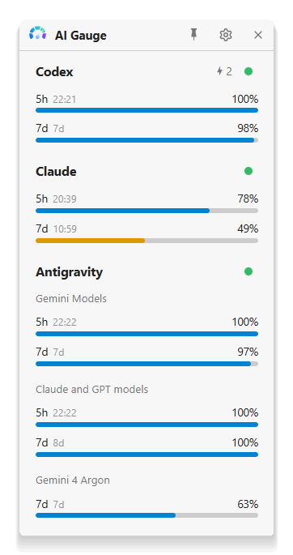
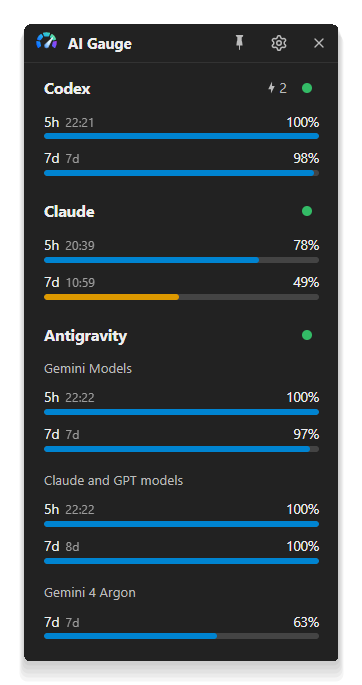
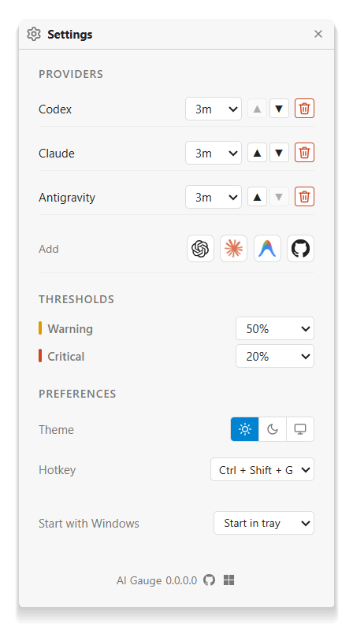
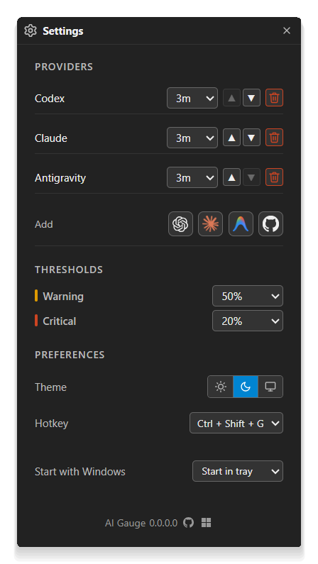

# Screenshots

|          | Light | Dark |
| -------- | ----- | ---- |
| Main     |  AI Gauge usage dashboard in light mode. |  AI Gauge usage dashboard in dark mode. |
| Settings |  AI Gauge settings in light mode. |  AI Gauge settings in dark mode. |

All four are captured from the same app run, so both themes show the same usage. Regenerate them
with `.\build.ps1 screenshot`; see [Listing screenshots](../development.md#listing-screenshots).
